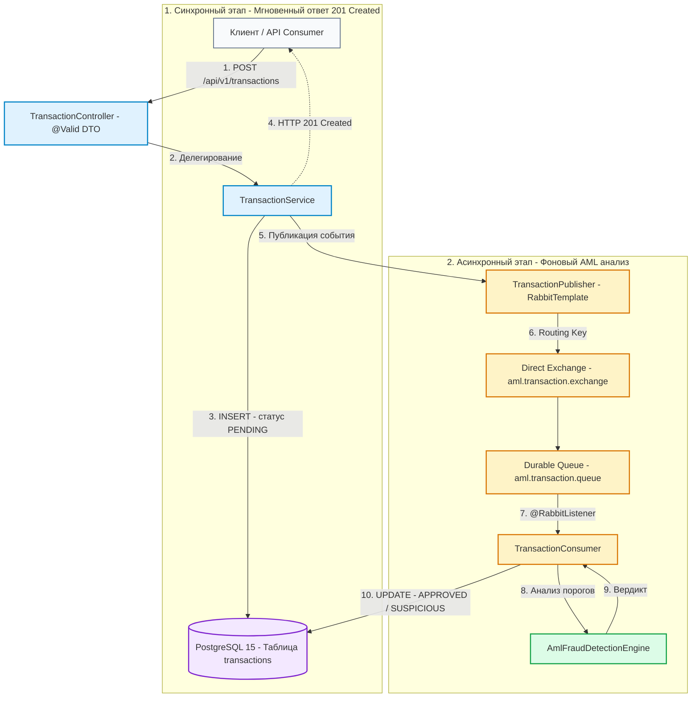

# AML Transaction Monitor & Compliance Service

[](https://www.oracle.com/java/)
[](https://spring.io/projects/spring-boot)
[](https://www.postgresql.org/)
[](https://www.rabbitmq.com/)
[](https://www.docker.com/)
[]()

Высокопроизводительный асинхронный микросервис финансового мониторинга и комплаенс-контроля (Anti-Money Laundering / Fraud Detection). Сервис предназначен для автоматизированного анализа потока финансовых транзакций в реальном времени, выявления подозрительных операций и изоляции аналитической нагрузки через брокер сообщений.

---

## Содержание
- [Ключевые особенности](#ключевые-особенности)
- [Технологический стек](#технологический-стек)
- [Архитектура и пайплайн обработки (Dataflow)](#архитектура-и-пайплайн-обработки-dataflow)
- [Быстрый запуск (Getting Started)](#быстрый-запуск-getting-started)
- [Спецификация API и живые примеры](#спецификация-api-и-живые-примеры)
  - [1. Создание транзакции (POST /api/v1/transactions)](#1-создание-транзакции-post-apiv1transactions)
  - [2. Проверка статуса: Кейс APPROVED (GET /api/v1/transactions/{id})](#2-проверка-статуса-кейс-approved-get-apiv1transactionsid)
  - [3. Проверка статуса: Кейс SUSPICIOUS (GET /api/v1/transactions/{id})](#3-проверка-статуса-кейс-suspicious-get-apiv1transactionsid)
  - [4. Ошибка валидации: Кейс 400 Bad Request (POST /api/v1/transactions)](#4-ошибка-валидации-кейс-400-bad-request-post-apiv1transactions)
  - [5. Ресурс не найден: Кейс 404 Not Found (GET /api/v1/transactions/{id})](#5-ресурс-не-найден-кейс-404-not-found-get-apiv1transactionsid)
- [Мониторинг базы данных и брокера](#мониторинг-базы-данных-и-брокера)
- [Тестирование и надежность (Test Coverage)](#тестирование-и-надежность-test-coverage)

---

## Ключевые особенности

* **Decoupled Architecture:** Полное разделение синхронного API приема платежей и асинхронной комплаенс-валидации. Клиент получает немедленный ответ `201 Created` со статусом `PENDING`, не блокируя поток выполнения.
* **Production-Ready AML Engine:** Нормализация валют (KZT, USD, EUR, RUB, GBP) и проверка пороговых сумм (порог 5 000 000 KZT или эквивалент от 10 000 USD).
* **Сквозная валидация:** Защита на уровне контроллеров через стандартизированный Jakarta Bean Validation (`@DecimalMin`, `@NotBlank`, `@Size`).
* **Отказоустойчивость и аудит:** Централизованный `GlobalExceptionHandler`, надежные durable-очереди RabbitMQ и индексирование PostgreSQL по отправителю (`account_from`) и времени (`created_at`).

---

## Технологический стек

| Категория | Технология / Библиотека | Точная версия | Назначение |
| :--- | :--- | :--- | :--- |
| **Язык платформы** | Java (OpenJDK) | 17 (LTS) | Базовый рантайм |
| **Основной фреймворк** | Spring Boot | 4.1.2 | Стартеры, автоконфигурация |
| **Ядро фреймворка** | Spring Framework | 7.0.10 | Контейнер IoC, Dependency Injection |
| **Web-движок** | Spring Web MVC & Tomcat | 7.0.10 / 11.0.27 | REST API, Embedded Servlet-контейнер |
| **ORM & Персистентность** | Hibernate ORM | 7.4.13.Final | JPA-реализация, генерация SQL, DDL |
| **Спецификация JPA** | Jakarta Persistence API | 3.2.0 | Интерфейсы сущностей и аннотаций БД |
| **Пул соединений** | HikariCP | 7.0.2 | Высокопроизводительный пул подключений к БД |
| **Драйвер БД** | PostgreSQL JDBC Driver | 42.7.14 | Сетевой драйвер доступа к PostgreSQL |
| **Сервер БД** | PostgreSQL (Docker image) | 15-alpine | Реляционная СУБД (docker-compose) |
| **Брокер сообщений** | RabbitMQ (Docker image) | 3.13-management-alpine | AMQP-сервер с Management UI (docker-compose) |
| **Интеграция AMQP** | Spring AMQP / Spring Rabbit | 4.1.2 | `RabbitTemplate`, `@RabbitListener`, бины очередей |
| **Сериализация сообщений**| Jackson Databind & JSR-310 | 2.21.7 | JSON-конвертер сообщений и поддержка дат `Instant` |
| **Валидация данных** | Hibernate Validator | 9.1.5.Final | Реализация Jakarta Validation API 3.1.1 |
| **Генерация кода** | Project Lombok | 1.18.48 | Аннотации `@Getter`, `@Setter`, `@Builder`, `@Slf4j` |
| **Фреймворк тестирования**| JUnit Jupiter | 6.0.3 | Движок модульного тестирования |
| **Мокирование** | Mockito Core | 5.23.0 | Мокирование зависимостей в тестах |

---

## Архитектура и пайплайн обработки (Dataflow)



### Архитектурные преимущества:
1. **Отсутствие блокировок (Zero Latency Penalty):** Медленные или сложные внешние AML-проверки (скоринг, черные списки, внешние реестры) выполняются консьюмером в фоновом пуле воркеров.
2. **Гарантия сохранности данных:** Транзакция фиксируется в PostgreSQL до отправки в очередь. При сбое брокера или пиковых нагрузках статус остается в `PENDING` и может быть обработан повторно.
3. **Горизонтальное масштабирование:** Количество воркеров-консьюмеров можно масштабировать независимо от веб-инстансов сервиса.

---

## Быстрый запуск (Getting Started)

### Предварительные требования
* **JDK 17** или новее
* **Docker** и **Docker Compose**
* Порты `5432` (PostgreSQL), `5672` и `15672` (RabbitMQ), `8080` (Spring Boot) должны быть свободны.

### 1. Запуск инфраструктуры
В корне проекта запустите контейнеры PostgreSQL и RabbitMQ:
```bash
docker compose up -d
```
Проверьте статус контейнеров:
```bash
docker compose ps
```

* **RabbitMQ Management UI:** [http://localhost:15672](http://localhost:15672) (Логин: `guest`, Пароль: `guest`)
* **PostgreSQL:** `localhost:5432`, БД: `aml_db`, Пользователь: `aml_user`, Пароль: `aml_password`

### 2. Запуск приложения
Запустите микросервис через Maven Wrapper:

* **Linux / macOS:**
  ```bash
  ./mvnw spring-boot:run
  ```
* **Windows (PowerShell):**
  ```powershell
  .\mvnw.cmd spring-boot:run
  ```

Приложение запустится на порту `8080`.

---

## Спецификация API и живые примеры

Базовый путь API: `/api/v1/transactions`

### 1. Создание транзакции (`POST /api/v1/transactions`)
Принимает запрос на перевод, регистрирует его со статусом `PENDING` и отправляет событие в брокер.

#### Запрос:
```bash
curl -X POST http://localhost:8080/api/v1/transactions \
  -H "Content-Type: application/json" \
  -d '{
    "accountFrom": "KZ1234567890123456",
    "accountTo": "KZ9876543210987654",
    "amount": 150000.00,
    "currency": "KZT"
  }'
```

#### Ответ (`HTTP 201 Created`):
```json
{
  "id": "e391b0d2-9705-4f33-9118-a68132646d6b",
  "accountFrom": "KZ1234567890123456",
  "accountTo": "KZ9876543210987654",
  "amount": 150000.00,
  "currency": "KZT",
  "status": "PENDING",
  "riskNote": "Pending AML automated check",
  "createdAt": "2026-10-23T12:30:15.124Z"
}
```

---

### 2. Проверка статуса: Кейс APPROVED (`GET /api/v1/transactions/{id}`)
Запрос состояния транзакции, сумма которой не превышает лимит финансового мониторинга (сумма $\le$ 5 000 000 KZT).

#### Запрос:
```bash
curl -X GET http://localhost:8080/api/v1/transactions/e391b0d2-9705-4f33-9118-a68132646d6b
```

#### Ответ (`HTTP 200 OK`):
```json
{
  "id": "e391b0d2-9705-4f33-9118-a68132646d6b",
  "accountFrom": "KZ1234567890123456",
  "accountTo": "KZ9876543210987654",
  "amount": 150000.00,
  "currency": "KZT",
  "status": "APPROVED",
  "riskNote": "Automated check passed",
  "createdAt": "2026-10-23T12:30:15.124Z"
}
```

---

### 3. Проверка статуса: Кейс SUSPICIOUS (`GET /api/v1/transactions/{id}`)
Транзакция на крупную сумму (например, 7 500 000 KZT или > 10 000 USD), классифицированная антифрод-движком как подозрительная.

#### Запрос создания крупной транзакции:
```bash
curl -X POST http://localhost:8080/api/v1/transactions \
  -H "Content-Type: application/json" \
  -d '{
    "accountFrom": "KZ1234567890123456",
    "accountTo": "KZ9876543210987654",
    "amount": 7500000.00,
    "currency": "KZT"
  }'
```

#### Запрос статуса:
```bash
curl -X GET http://localhost:8080/api/v1/transactions/f8a25c11-6623-4481-9bd2-c74b1239aa10
```

#### Ответ (`HTTP 200 OK`):
```json
{
  "id": "f8a25c11-6623-4481-9bd2-c74b1239aa10",
  "accountFrom": "KZ1234567890123456",
  "accountTo": "KZ9876543210987654",
  "amount": 7500000.00,
  "currency": "KZT",
  "status": "SUSPICIOUS",
  "riskNote": "High amount threshold exceeded",
  "createdAt": "2026-10-23T12:32:00.410Z"
}
```

---

### 4. Ошибка валидации: Кейс 400 Bad Request (`POST /api/v1/transactions`)
Демонстрация работы `GlobalExceptionHandler` при передаче некорректных параметров (пустые счета, отрицательная сумма, невалидный код валюты).

#### Запрос:
```bash
curl -X POST http://localhost:8080/api/v1/transactions \
  -H "Content-Type: application/json" \
  -d '{
    "accountFrom": "",
    "accountTo": "KZ9876543210987654",
    "amount": -500.00,
    "currency": "KAZAKHSTAN"
  }'
```

#### Ответ (`HTTP 400 Bad Request`):
```json
{
  "timestamp": "2026-10-23T12:33:45.892Z",
  "status": 400,
  "error": "Bad Request",
  "message": "Request validation failed",
  "path": "/api/v1/transactions",
  "fieldErrors": {
    "accountFrom": "Sender account (accountFrom) must not be blank",
    "amount": "Amount must be at least 0.01",
    "currency": "Currency must be exactly 3 characters (e.g. KZT, USD)"
  }
}
```

---

### 5. Ресурс не найден: Кейс 404 Not Found (`GET /api/v1/transactions/{id}`)
Обработка запроса по несуществующему идентификатору транзакции.

#### Запрос:
```bash
curl -X GET http://localhost:8080/api/v1/transactions/00000000-0000-0000-0000-000000000000
```

#### Ответ (`HTTP 404 Not Found`):
```json
{
  "timestamp": "2026-10-23T12:34:10.150Z",
  "status": 404,
  "error": "Not Found",
  "message": "Transaction with ID '00000000-0000-0000-0000-000000000000' not found",
  "path": "/api/v1/transactions/00000000-0000-0000-0000-000000000000"
}
```

---

## Мониторинг базы данных и брокера

### Проверка записей в PostgreSQL
Быстрый просмотр сохраненных транзакций через Docker CLI:
```bash
docker exec -it aml-postgres psql -U aml_user -d aml_db -c "SELECT id, amount, currency, status, risk_note FROM transactions ORDER BY created_at DESC LIMIT 5;"
```

### Очистка данных для повторного тестирования
* Очистить только таблицу транзакций:
  ```bash
  docker exec -it aml-postgres psql -U aml_user -d aml_db -c "TRUNCATE TABLE transactions;"
  ```
* Полный сброс (удаление контейнеров и Volumes):
  ```bash
  docker compose down -v && docker compose up -d
  ```

---

## Тестирование и надежность (Test Coverage)

Проект покрыт всесторонними модульными и слайс-тестами на базе **JUnit 5**, **Mockito** и **Spring MockMvc**. 

### Структура тестового набора:
1. **`AmlFraudDetectionEngineTest` (5 тестов):**
   * Граничные значения для KZT (до 5 000 000 и свыше).
   * Граничные значения для USD (до 10 000 и свыше).
   * Конвертация и проверка эквивалента в EUR/других валютах.
2. **`TransactionServiceTest` (3 теста):**
   * Создание сущности с начальным статусом `PENDING`.
   * Захват и верификация аргументов события RabbitMQ через `ArgumentCaptor`.
   * Обработка исключения `TransactionNotFoundException`.
3. **`TransactionConsumerTest` (1 тест):**
   * Вычитка сообщения из очереди, вызов AML-движка и сохранение обновленного статуса в БД.
4. **`TransactionControllerTest` (4 теста):**
   * HTTP 201 при успешной валидации запроса.
   * HTTP 400 и разбор детальной структуры `fieldErrors`.
   * HTTP 200 при получении существующей транзакции.
   * HTTP 404 при попытке запросить несуществующий ID.
5. **`TransactionMonitorApplicationTests` (1 тест):**
   * Проверка корректной инициализации Spring ApplicationContext в изолированном H2 in-memory окружении.

### Запуск тестов:
```bash
./mvnw test
```

### Отчет выполнения:
```text
[INFO] Running kz.aml.transactionmonitor.controller.TransactionControllerTest
[INFO] Tests run: 4, Failures: 0, Errors: 0, Skipped: 0
[INFO] Running kz.aml.transactionmonitor.service.AmlFraudDetectionEngineTest
[INFO] Tests run: 5, Failures: 0, Errors: 0, Skipped: 0
[INFO] Running kz.aml.transactionmonitor.service.TransactionConsumerTest
[INFO] Tests run: 1, Failures: 0, Errors: 0, Skipped: 0
[INFO] Running kz.aml.transactionmonitor.service.TransactionServiceTest
[INFO] Tests run: 3, Failures: 0, Errors: 0, Skipped: 0
[INFO] Running kz.aml.transactionmonitor.TransactionMonitorApplicationTests
[INFO] Tests run: 1, Failures: 0, Errors: 0, Skipped: 0
[INFO] 
[INFO] Results:
[INFO] Tests run: 14, Failures: 0, Errors: 0, Skipped: 0
[INFO] ------------------------------------------------------------------------
[INFO] BUILD SUCCESS
```

---

## Тестирование через Postman

В корне репозитория подготовлен файл коллекции: [`postman_collection.json`](./postman_collection.json).
Для быстрого запуска импортируйте его в Postman (**File -> Import**):
* Сценарий «Зеленый коридор» (KZT $\le$ 5 000 000 -> `APPROVED`) с автосохранением ID в переменную.
* Сценарий «Подозрительная операция» (KZT > 5 000 000 -> `SUSPICIOUS`).
* Сценарий «Отказ валидации» (HTTP 400 со списком ошибок `fieldErrors`).
* Сценарий «Ресурс не найден» (HTTP 404).
